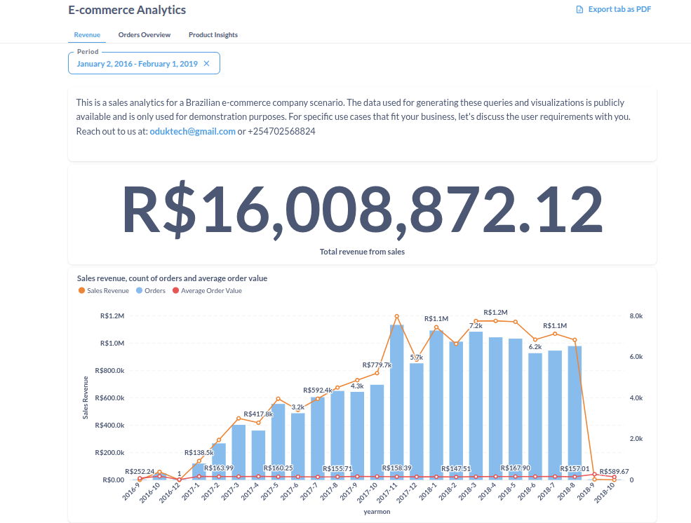
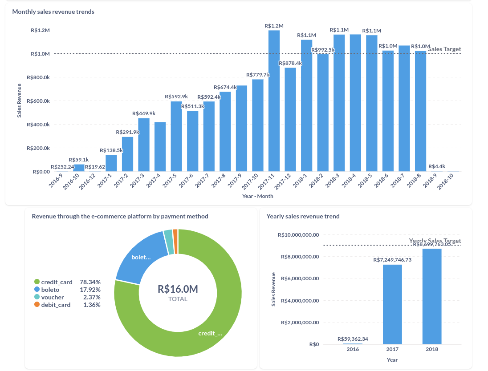
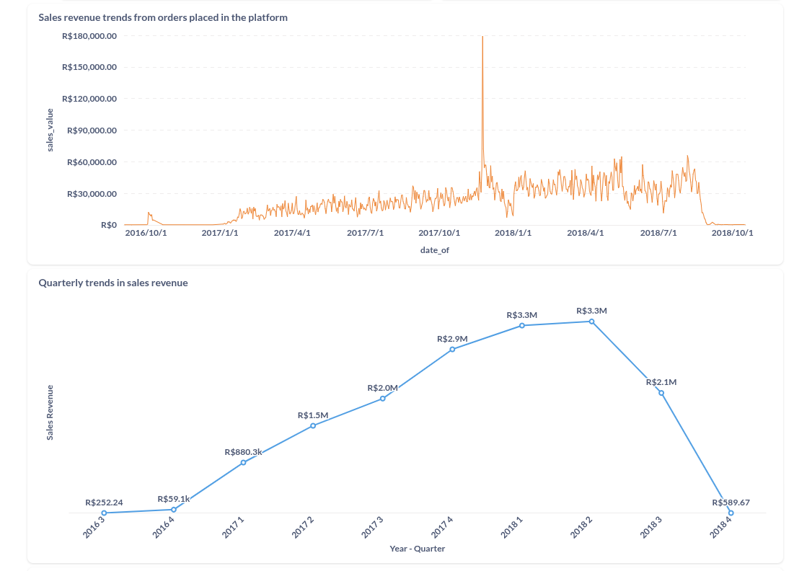
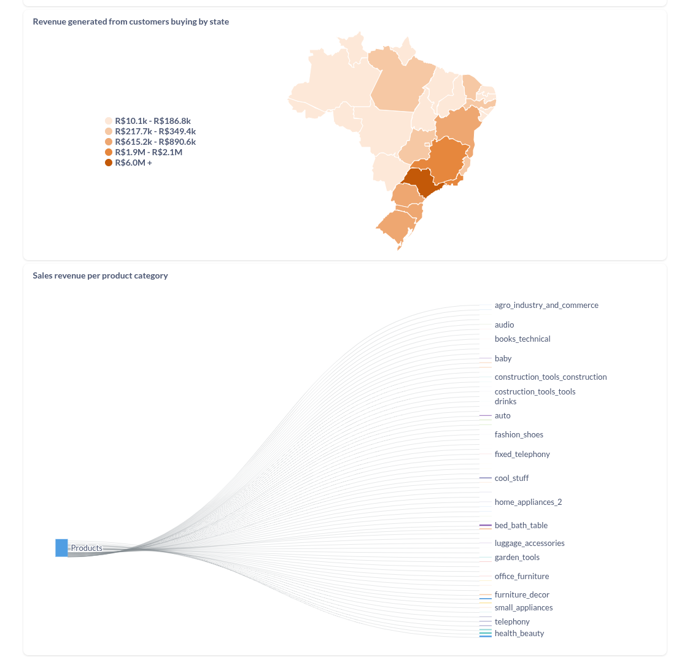
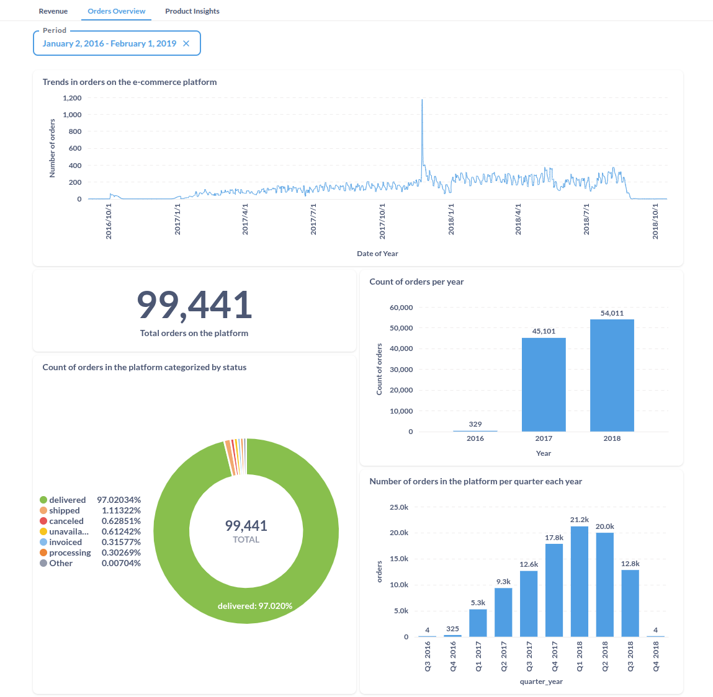
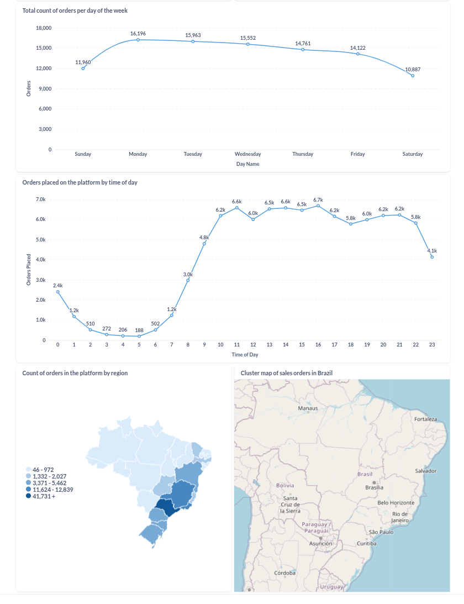
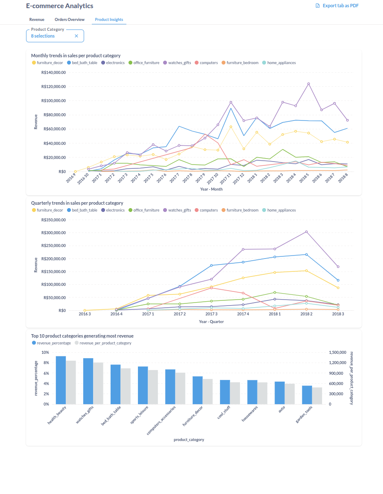

# Analytics on Brazilian Ecommerce
This is a data modelling and data analytics project, digging into insights of the 
Brazilian e-commerce market based on the Olist dataset. The dataset is free available from https://www.kaggle.com/datasets/olistbr/brazilian-ecommerce.

The dataset has information of 100k orders from 2016 to 2018 made at multiple marketplaces in Brazil.

Its features allows viewing an order from multiple dimensions: from order status, price, payment and freight performance to customer location, product attributes and finally reviews written by customers.

The dataset also contains a geolocation dataset that relates Brazilian zip codes to lat/lng coordinates.

This dataset is usefu in this project for demonstrating data cleaning and visualization using Pandas & matplotlib. Once a clear understanding of the dataset has been established, data modelling is done using SQL DDL, and analytics has been carried out in Metabase.

Metabase is an open-source data analytics platform providing self-service analytics.

Click here to get the <a href="https://analytics.luminererp.com/public/dashboard/3fdb94bd-9be6-4c1b-9dbd-974a913ce136?period=2016-01-02~2019-02-01&product_category=computers&product_category=bed_bath_table&product_category=watches_gifts&product_category=home_appliances&product_category=furniture_bedroom&product_category=office_furniture&product_category=electronics&product_category=furniture_decor&tab=5-revenue">public dashboard</a>.

# The data models

## Analytics Results
Sales revenue against orders placed in the platform

Monthly Sales Revenue trends

Revenue trends

Ordering trends

Orders and regions

Products analytics

